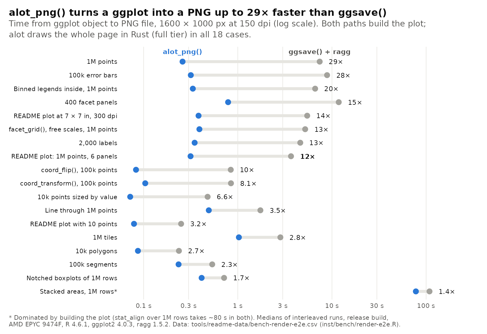
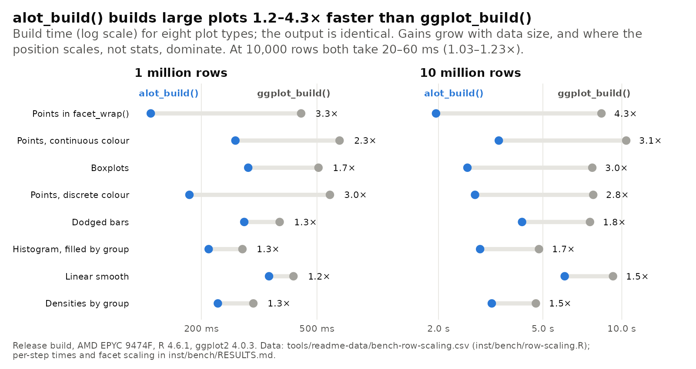
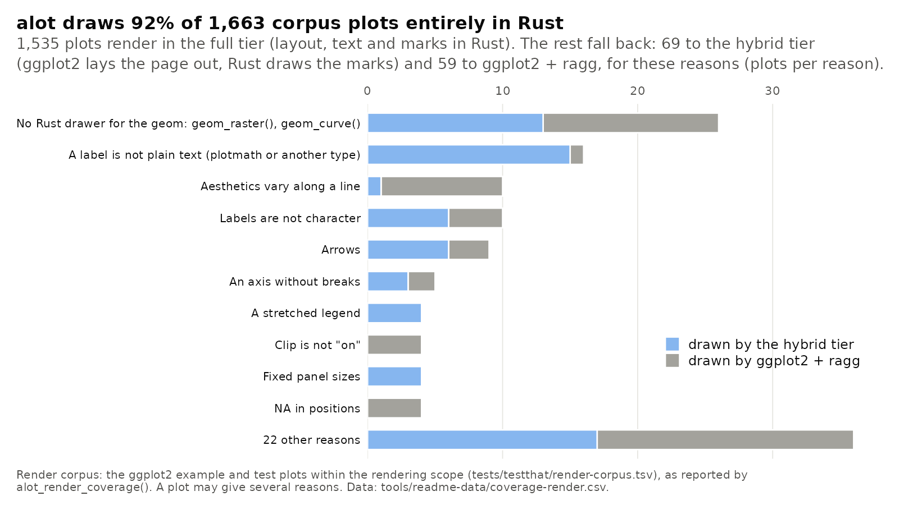

# alot

A Rust backend for building and rendering ggplot2 plots.

```r
library(ggplot2)
p <- ggplot(mtcars, aes(wt, mpg)) + geom_point()
b <- alot::alot_build(p)  # identical to ggplot2::ggplot_build(p)
alot::alot_coverage(p)    # which components ran in Rust vs ggplot2
alot::alot_print(p)       # like print(p), but builds with alot and renders with the best tier;
                          # re-renders at the new size when the plot pane is resized
options(alot.autoprint = TRUE)  # makes print(p), and autoprinting p, do the same
```

`alot_build()` mirrors `ggplot2:::build_ggplot()` step by step. Pipeline
components (stats, positions, ...) with a registered Rust kernel run in
Rust; everything else falls back to ggplot2's own methods, so results are
always identical to ggplot2. Targets ggplot2 4.0.x.

## Example benchmark

A faceted scatter plot of 1e6 rows with a log-scaled x axis, a continuous
colour scale and a discrete shape scale:

```r
library(ggplot2)
set.seed(42)
n <- 1e6
d <- data.frame(
  income = exp(rnorm(n, 10, 1)),
  spend = runif(n, 0, 100),
  age = sample(18:90, n, TRUE),
  region = factor(sample(c("North", "South", "East", "West", "Central", "Islands"), n, TRUE)),
  segment = factor(sample(c("A", "B", "C", "D"), n, TRUE))
)
p <- ggplot(d, aes(income, spend, colour = age, shape = segment)) +
  geom_point(alpha = 0.3) +
  scale_x_log10() +
  scale_colour_viridis_c() +
  facet_wrap(~region)

size <- list(width = 1600, height = 1000, units = "px", dpi = 150)

# ggplot2 drawing on ragg: 3.67 s
system.time(do.call(ggsave, c(list("ggplot2.png", p, device = ragg::agg_png), size)))
# alot: 0.32 s
system.time(do.call(alot::alot_png, c(list(p, "alot.png"), size)))
```

That is about 11× faster from ggplot to PNG file. `alot_png()` builds the
plot with `alot_build()` (about 2.5× faster than `ggplot_build()` here),
then lays out and draws the whole page in Rust (its full tier) and encodes
the PNG in Rust. Times are medians of interleaved runs on a release build
(AMD EPYC 9474F, 16 threads, R 4.6.1, ggplot2 4.0.3, ragg 1.5.2).



Across 18 benchmark plots, `alot_png()` is 1.4–29× faster end to end. The
slowest case spends almost all its time in a stat that both paths share.
Building alone gains less, and more with more rows:



The data behind each figure is in `tools/readme-data/`, and
`tools/readme-figures.R` redraws them (with `alot_png()`). See
[inst/bench/RESULTS.md](inst/bench/RESULTS.md) for per-stage and per-step
numbers.

## Coverage

alot falls back to ggplot2 for anything it doesn't handle exactly, so
coverage is about speed, not correctness. Over the corpus of about 1,900
plots from ggplot2's own examples and tests (`tests/testthat/corpus/`),
93% of build components run in Rust; stats and position adjustments are
the gap:


For rendering, `alot_render_coverage(p)` reports the tier a plot is drawn
in. Of the 1,663 corpus plots in the rendering scope, 92% are drawn
entirely in Rust; the rest fall back to the hybrid tier (ggplot2 lays the
page out, Rust draws the marks) or to ggplot2 itself:



## Tests

Tests compare every build against `ggplot2::ggplot_build()`:

```sh
NOT_CRAN=true Rscript -e 'pkgload::load_all(); testthat::test_dir("tests/testthat", load_package = "none")'
```
